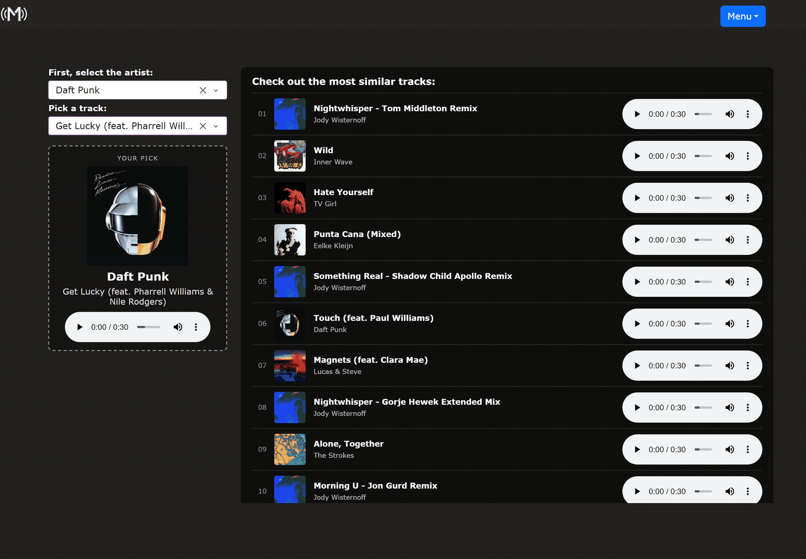
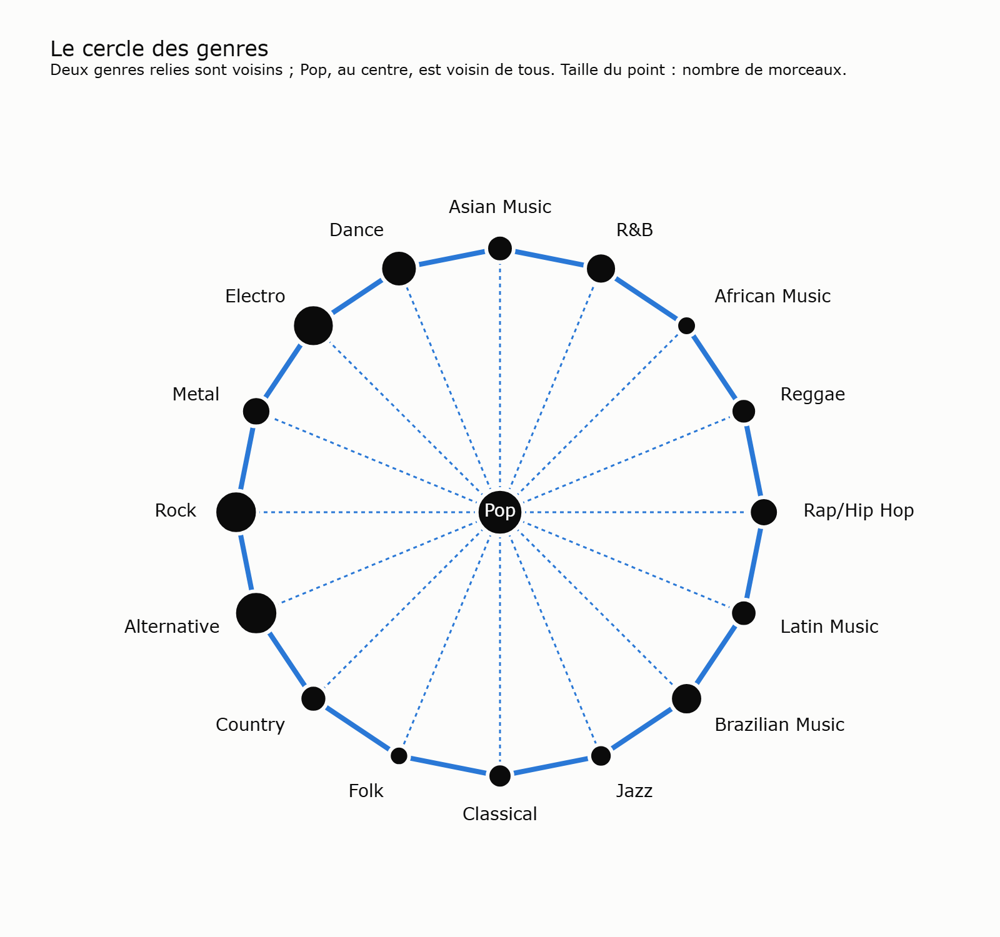

# Museme

Pick a track, hear ten that sound like it. Museme recommends music by cosine
similarity over a catalogue of 5,457 tracks: 3,803 collected in 2021 and 1,654
added in October 2026. Each track is described by how it sounds (a
512-dimension embedding of its 30-second preview, from the pretrained CLAP
audio model) and by its Deezer genre.

**[➡ Live demo](https://museme-site.onrender.com)**

The recommendation engine is Python; the site is static. Every track's ten
nearest neighbours are computed once by the engine and shipped as JSON, so the
page answers instantly and never waits for a server — see
[From Dash to a static site](#from-dash-to-a-static-site-october-2026).

Originally written in 2021 on Python 3.7 / Dash 1.19, brought back to life in
2026 — see [Migration](#migration-2021---2026).



## Where the data comes from

The catalogue is not an off-the-shelf dataset — it was assembled for this project
in 2021, then extended in 2026.

1. **Scraped from Spotify** — artist, album, title, genre tag, cover art and the
   30-second preview MP3 of each track. The `Preview` and `Cover` columns still
   carry those CDN links (`p.scdn.co`, `i.scdn.co`), and they are what the app
   plays and displays today.
2. **Genres** — since October 2026, `Main_Genre` and `family_genre` hold the
   genre of the track's album on Deezer: Deezer's 16 genres, plus `Country`
   (Deezer returns no genre for country albums, so the 149 tracks tagged
   country, bluegrass or honky-tonk in 2021 form that genre). 27 tracks have no
   genre. The 2021 Spotify tags (77 fine-grained "genre seeds", noisy at the
   artist level) are kept in `data/genres_2021.csv`.
3. **Audio descriptors, computed from the signal (2021)** — every preview was
   decoded and reduced with [`librosa`](https://librosa.org) to **63
   descriptors**, almost all of them derived from the Short-Time Fourier
   Transform of the waveform:

   | Descriptor | What it measures |
   |---|---|
   | `chroma_stft` | energy per pitch class, read straight off the STFT |
   | `spectral_centroid` | where the centre of mass of the spectrum sits — "brightness" |
   | `spectral_bandwidth` | how spread out the spectrum is around that centre |
   | `rolloff` | the frequency below which 85% of the energy falls |
   | `spectral_contrast` | peak-to-valley difference within each sub-band |
   | `mfcc1` … `mfcc20` | discrete cosine transform of the log-mel spectrum: timbre |
   | `tonnetz` | position in tonal space (fifths, thirds) |
   | `harmony`, `onset`, `polyfeat` | harmonic content, note attacks, spectral slope |
   | `rms`, `zero_crossing_rate`, `tempo` | loudness, noisiness, beats per minute |

   Every one of them except `tempo` is kept as **both mean and variance** over the
   preview — 31 quantities x 2, plus tempo, is the 63. They are still in the
   CSV, but since October 2026 the app no longer uses them (see below). A 2026
   review also found that the 2021 extraction read the stereo preview as mono
   at the wrong rate: the analysed signal was four times too long and two
   octaves too low.
4. **1,654 tracks added in October 2026** (909, then 745 hits from the 1980s
   to today), from Spotify's public embed pages, with
   the same descriptors (the 2021 extraction code was recovered and ported, bugs
   included) — see [Growing the catalogue](#growing-the-catalogue).
5. **CLAP audio embeddings (2026)** — one 512-dimension vector per track,
   computed locally for the whole catalogue and stored in
   `data/embeddings_clap.npy`.

`data/df_66features_clean2.csv` holds the 2021 features for 4,950 tracks (used
by the 2021 summary page, kept for history); the recommendation catalogue
(`data/df_recommendation.csv`) has 5,457.

## How tracks are compared

- **Sound first.** Each preview goes through
  [CLAP](https://github.com/LAION-AI/CLAP) (`laion/larger_clap_general`,
  Apache 2.0), a model pretrained by LAION on pairs of audio and text
  descriptions (music, speech, sounds). The preview is cut into 10-second
  chunks at 48 kHz; each chunk gives 512 numbers; the chunks are averaged into
  one vector per track. The engine standardises each dimension across the
  catalogue. CLAP runs locally only; the site never sees the vectors.
- **Genre helps.** 17 more columns describe the genre: the main genre (weight
  1), the other Deezer genres of the album (weight 0.5), combined through a
  circle of genres where neighbours count as half-similar and Pop, close to
  everything, sits on its own axis. That block is multiplied by a weight of 4.
  No genre ever pushes another away: at worst it adds nothing.
- **Cosine similarity** between the chosen track and the whole catalogue; the
  10 closest tracks are shown. `python -m pipeline site` computes them for
  every track at once, checks each list against the engine's
  `recommandation_cosine` (5,457 / 5,457 identical), and writes
  `web/data/`.

**Why CLAP.** The 2021 descriptors, three corrected versions of them and CLAP
were compared over the whole catalogue, then in a blind listening test: 20
tracks, the 5 nearest neighbours of each version shuffled together (277
suggestions), each rated close, medium or unrelated, without knowing which
version made it.

| Audio description | Close | Medium | Unrelated |
|---|---|---|---|
| 2021 descriptors | 17% | 28% | 55% |
| Corrected descriptors (best version) | 31% | 34% | 35% |
| **CLAP** | **63%** | 26% | **11%** |

CLAP's suggestions scored higher than those of the 2021 descriptors for 17 of
the 20 tracks.

**Why a genre weight of 4.** About half of the recommendations (54%) stay in
the track's genre (87% with the previous settings), which leaves room for
close-sounding tracks from other genres. 66% of tracks find another song by
the same artist among their recommendations (53% before), although the model
never sees the artist.

Settings, tests, listening results and how to roll back:
[`docs/recommandation.md`](docs/recommandation.md) (in French).

## Running it

The site is plain HTML, CSS and JavaScript: no framework, no build step. Any
static file server works. It cannot be opened as a local file, because it
fetches its data.

```powershell
# from the project folder
.\.venv\Scripts\python.exe -m http.server 8000 -d web
```

Then open http://127.0.0.1:8000/

Changing the recommendations (engine settings, genres, new tracks) needs the
engine, on Python 3.12 (`py -3.12 --version`):

```powershell
py -3.12 -m venv .venv
.\.venv\Scripts\python.exe -m pip install -r requirements.txt
.\.venv\Scripts\python.exe -m pipeline site    # rewrites web/data/ (~2 min with the full check)
node --test tests/search.test.mjs                # search tests on the real catalogue (Node 22+)
```

### What the user does

1. Types in a single search bar: title, artist or album, in any order, with or
   without accents (*lucky get*, *daft punk get lucky* and *beyonce* all
   work). Suggestions show the cover; arrows and Enter work, and `/` jumps to
   the bar. The dice button starts from a random track.
2. The chosen track appears on the left, its 10 recommendations on the right.
3. Clicking a recommendation plays its preview in the player bar at the
   bottom of the screen. Previews follow one another, from the chosen track
   through the ten recommendations. *Find similar*, on a row or in the
   player, makes that track the new starting point.

Under 600 px the page becomes a single column; the theme follows the
device's light or dark setting. The *About* page explains the method.

## Structure

```
web/                  the site, published as is
  index.html, about.html, style.css
  app.js                search, recommendations, player
  search.js             search without the DOM (tested by tests/search.test.mjs)
  data/                 catalog.json and neighbors.json, written by python -m pipeline site
components/
  engine/functions.py   the recommendation engine (Python)
data/                 catalogue (df_recommendation.csv), CLAP vectors, Deezer and 2021 genres
pipeline/             catalogue growth and site data (local only, never deployed)
tests/                search tests (Node)
notebooks/            genre classifier, audio benchmark (evaluation_audio.ipynb)
docs/                 screenshot, genre circle, recommendation notes (recommandation.md, in French)
legacy/               scripts outside the app, kept for reference
render.yaml           Render deployment blueprint (static site)
requirements.txt      engine (pandas, numpy, scikit-learn)
requirements-pipeline.txt   pipeline dependencies (librosa, torch...)
```

## Growing the catalogue

`pipeline/` adds tracks to `data/df_recommendation.csv`, then their CLAP
vectors to `data/embeddings_clap.npy`. It runs locally only: librosa, numba,
torch and transformers are not deployed. It also needs `ffmpeg` on the PATH,
and the CPU build of torch (see `requirements-pipeline.txt`).

```powershell
.\.venv\Scripts\python.exe -m pip install -r requirements-pipeline.txt
.\.venv\Scripts\python.exe -m pipeline validate    # does the extractor reproduce the 2021 vectors?
.\.venv\Scripts\python.exe -m pipeline collect     # tracks from the playlists in pipeline/playlists.csv
.\.venv\Scripts\python.exe -m pipeline extract     # 63 descriptors per track
.\.venv\Scripts\python.exe -m pipeline merge       # append to the CSV (--dry-run to check)
.\.venv\Scripts\python.exe -m pipeline embeddings  # CLAP vectors of the new tracks -> data/embeddings_clap.npy, then web/data/
.\.venv\Scripts\python.exe -m pipeline deezer      # Deezer genres, for notebooks/classifieur_genre.ipynb
.\.venv\Scripts\python.exe -m pipeline genre-lists # secondary genres -> data/genres_deezer.csv
.\.venv\Scripts\python.exe -m pipeline site        # recommendations of every track -> web/data/
```

The audio cache, the Spotify pages and intermediate outputs go to
`%LOCALAPPDATA%\museme\` (set `MUSEME_WORK_DIR` to change it), outside
OneDrive. `collect`, `extract` and `embeddings` resume where they stopped.
**After `merge`, run `embeddings`** (about 2 s per track on CPU): it refuses to
write if a track has no CLAP vector, then refreshes the site's data. After
changing genres or engine settings, run `site` on its own.

Worth knowing:

- **The descriptors reproduce the 2021 ones, bugs included.** The original
  extraction code was recovered and ported to `pipeline/features_legacy.py`.
  Its quirks are kept on purpose so that the same track gives the same vector:
  audio as unnormalised 16-bit integers, stereo MP3 interleaved and analysed as
  mono at 22,050 Hz, `mfcc{k}` = statistics of the first k coefficients taken
  together. The librosa 0.8 -> 0.11 changes are neutralised (the 0.8.1 CQT is
  kept in `pipeline/_cqt08.py`). `validate` checks this on 45 catalogue
  tracks: largest deviation 7e-5 standard deviation, 10 out of 10 identical
  recommendations.
- **Source: Spotify's public embed pages** (`open.spotify.com/embed/...`). The
  Web API stopped serving previews in November 2024 and requires a Premium
  account since March 2026. The embed pages provide the 30-second preview
  without an account, in the same format as the catalogue, but they are not an
  API: they can change or disappear without notice, and this use is not
  covered by Spotify's developer terms.
- **One vector per song.** `collect` skips tracks already in the catalogue
  (same preview, or same artist and normalised title) and duplicates across
  playlists. Same titles under another artist (covers, P!nk / Pink) are kept
  but listed in `%LOCALAPPDATA%\museme\out\doublons_possibles.csv`, to review
  before `merge`. Each `collect` archives the previous batch as
  `new_tracks_<date>.csv`.
- **Genres come from Deezer.** `deezer` looks up the genre of each track's
  album on Deezer's public API (no account), into
  `%LOCALAPPDATA%\museme\out\deezer_genres.csv`. The notebook
  `notebooks/classifieur_genre.ipynb` fixes these genres, fills in the tracks
  that were not found (the artist's genre, or a mapping from the 2021 genre),
  then writes them to `Main_Genre` and `family_genre` (same value) through
  `pipeline/genres.py`.
- **The genre circle**: two neighbouring genres are close. The image below
  puts Pop in the centre, as the classifier notebook does to judge predictions
  leniently (a neighbouring genre is a forgivable mistake). The app gives Pop
  its own axis instead: in the centre, it cancelled the genre of 16% of the
  catalogue.

  

- **The genre classifier** (same notebook) predicts the genre from the 63
  descriptors. Five models compared on 940 test tracks (exact genre, exact
  balanced across genres, exact or neighbour on the circle): SVC
  39% / 43% / 74%, gradient boosting 40% / 34% / 80% (but a quarter of its
  answers are Pop), random forest 38% / 40% / 74%, cosine kNN 36% / 35% / 74%,
  logistic regression 33% / 41% / 68%. The SVC is kept.
- **Merging appends rows without rewriting the file**: existing rows stay
  byte-for-byte identical, and the schema does not change. The 63 descriptors
  are still computed and written to the CSV (the genre classifier and
  `validate` use them), but the app no longer does.

## Deployment (Render, static site)

`render.yaml` describes a static site: Render serves `web/` from its CDN. There
is no server, so nothing sleeps and there is no memory limit to watch. Nothing
is built on Render either: `web/data/` is written locally by
`python -m pipeline site` and committed, like `data/embeddings_clap.npy`.
Every file is served with `Cache-Control: no-cache`, so the browser revalidates
it on each visit (a 304 when it has not changed) and a new export shows up at
once.

On https://render.com: *New > Blueprint*, point it at the GitHub repo, deploy.
A Render service cannot change runtime after creation: the static site is a
separate service from the former Python one.

## From Dash to a static site (October 2026)

The Dash app, on Render's free plan, was slow for reasons no code change could
fix: the server went to sleep after 15 minutes without traffic, it had 0.1 CPU,
and every click was a round trip to it. The catalogue only changes when the
pipeline runs, though, so the recommendations of every track can be computed
in advance, and checked against the live function, which leaves the browser
only a lookup to do. Measured on 2026-10-11, on the live sites:

| | Dash app (Render free) | Static site |
|---|---|---|
| First visit after 15 min idle | 63 s, waking the server | no server to wake: search usable in 1.3 s |
| Recommendations after a click | 1.1-1.2 s (3 s the first time) | 5 ms: a lookup in `neighbors.json` |
| Search | two dropdowns; the full title list took 2.4 s | one bar, 1.4 ms per keystroke, in the browser |
| Download on the first visit | ~6.2 MB, including a 5.8 MB background video and 330 KB of Dash, React and Bootstrap | 406 KB (Brotli): 16 KB of code, 383 KB of data |
| Covers in the list | 640 px, 206 KB each | 64 px, 3 KB each |
| Audio | 11 native players | one shared player bar |

The recommendations themselves did not change: same engine, same settings,
4,724 / 4,724 lists identical. The last version of the Dash app is tagged
`dash-final`.

## Migration 2021 -> 2026

*History: this section and the next one describe the Dash app, replaced by
the static site on 2026-10-11 (tag `dash-final`).*

The business logic was deliberately left untouched. Only what actually
prevented the app from running was fixed:

| Fix | File | Why |
|---|---|---|
| `dash_html_components` / `dash_core_components` -> `from dash import html, dcc` | the 4 pages in `components/layout/` | packages absorbed into `dash`, then removed |
| `DataFrame.append` -> direct indexing | `components/engine/functions.py` | removed in pandas 2.0 |
| `app.run_server()` -> `app.run()` | `index.py` | renamed in Dash 3 |
| Normalised the return of `get_loc` | `components/engine/functions.py` | 31 titles in the CSV are duplicates: `get_loc` returned a boolean mask and crashed the recommendation |
| Dropped the `librosa` / `matplotlib` imports | `functions.py`, `index.py` | imported but never called; they dragged in an audio stack that will not compile on 3.12 |
| `gunicorn app:server` -> `gunicorn index:server` | `Procfile` | `app.py` has no layout: the deployment was serving a blank page |

## Going live in 2026

Changes made for hosting and rendering:

| Change | File | Why |
|---|---|---|
| Tab title `Museme` + `assets/favicon.ico` | `app.py`, `index.py` | the tab read `Dash`. The favicon is generated from `assets/images/Logo_Museme.jpg`; Dash serves `assets/favicon.ico` automatically |
| Left column grouped into `.left-panel` | `components/layout/home.py`, `assets/style.css` | `.input-box` (top 10%) and `.track-audio-player-box` (top 40%) were each absolutely positioned on their own: their heights do not depend on the window, so the two blocks overlapped as soon as a track was selected. They are now stacked in a single flex container |
| `dbc.Row` removed from the selection block | `components/layout/home.py` | Bootstrap's negative margins pushed the dropdowns out of their box |
| Similarity computed on a single row | `components/engine/functions.py` | the full 3,815 x 3,815 matrix was 116 MB, doubled by the DataFrame copy: a 243 MB peak per request. The matrix being symmetric, the result is identical |
| Catalogue and features cached (`lru_cache`) | `components/engine/functions.py` | the 5 MB CSV was re-read on every callback |
| Absolute data paths | `components/engine/functions.py` | relative paths assumed the working directory was the project root |
| Recommendation column moved into `.right-panel`, bounded and scrollable | `components/layout/home.py`, `assets/style.css` | the block was absolutely positioned with no height limit: its last rows fell off the screen, and the page body (entirely absolute, therefore zero-height) offered no scrolling to reach them |
| Translucent dark backdrop under the recommendations | `assets/style.css` | white text became unreadable over the bright frames of the video |
| Recommendation rows generated by a loop, in a CSS grid | `components/layout/home.py` | the 10 rows were hand-written as `dbc.Row` with 4 equal columns: the 50 px cover took a quarter of the width while long titles wrapped onto three lines |
| Tracks identified by their row number, not their title; search across all titles when no artist is selected | `index.py`, `components/engine/functions.py` | 54 titles exist for several artists (*Baby*: Brandy and Justin Bieber): picking one displayed and recommended from the first one in the CSV. With no artist selected, the title list was empty |
| Placeholder cover when `Cover` is missing | `components/layout/home.py` | 61 tracks in the catalogue have no cover: the code produced ``, i.e. a broken-image icon |
| Background video re-encoded: 179 MB -> 5.7 MB | `assets/videos/background.mp4` | above GitHub's 100 MB per-file limit. 854x480, no audio track, with slight blur from the encode — invisible, since the CSS already applies `blur(5px)` |

Effect on the recommendations, measured over 7 tracks (one of them a duplicate):
results strictly identical to the old implementation, peak memory 243 MB -> 17 MB,
and 1.22 s -> 0.02 s once the cache is warm.

Known issues, deliberately left alone:

- `index.py` creates a second `Dash` object that shadows the one in `app.py`.
  Shaky, but it works.
- Moving from Bootstrap 4 to 5 may cause slight visual differences; most of the
  design comes from `assets/style.css` anyway.

## License

MIT — see [LICENSE](LICENSE).
